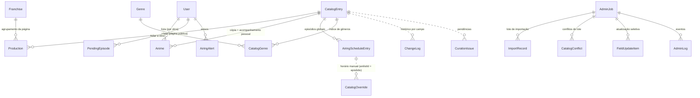

# Visão geral do catálogo e da administração

Este documento resume o catálogo e a área de administração no estado em que ficaram depois das Fases 2 a 10.

## Entidades e relações

- **Identidade.** O id do catálogo (`CatalogEntry.id`) identifica a obra. `anilistId`, `anidbId`, `kitsuId` e `malId` são identificadores externos (ADR 0008).
- **Episódio.** É global e se identifica por (obra, número): `AiringScheduleEntry` (ADR 0009). Não existe progresso pessoal por episódio.
- **Acompanhamento.** É por obra: `Anime.watchState`, `waiting`, `isFavorite`, `userScore` e `PendingEpisode` ("Adiar a obra").

As regras campo a campo estão em [fonte-de-verdade.md](fonte-de-verdade.md).

## Abas da administração

O papel define o que cada pessoa vê (Fase 9): **C** = curador, **M** = moderador, **A** = administrador. O administrador vê tudo.

| Aba | Para quê | Papel |
|---|---|---|
| Dashboard | operação do catálogo (importações, matching, conflitos) | C |
| Saúde do catálogo | indicadores por impacto; integridade; atividade recente | C |
| Catálogo de obras | lista canônica; detalhe; edição com revisão, proteção e 409; publicar e despublicar | C |
| Episódios | episódios globais: situação, data (com a certeza), edição, mover de obra, histórico | C |
| Calendário | período no horário efetivo; adiados e sem data; "por que não apareceu?"; releitura da agenda | C |
| Correspondências | importação do AniDB e AniDB→AniList lado a lado; risco exige motivo; revisar depois; CSV | C |
| Atualização seletiva | AniList campo a campo: coleta → diferenças → escolha → prévia → execução → resultado | C |
| Franquias | ordem, papel e temporada das obras; protegida; desfazer | C |
| Produções e franquias | páginas públicas e agrupamentos (já existia) | C |
| Taxonomia | gêneros: criar, variações, renomear, mesclar, excluir com transferência | C |
| Traduções | sinopses em português por estado (automática, revisada, manual); títulos e leituras | C |
| Pendências | fila priorizada da curadoria; resolver, ignorar com justificativa, reabrir; indicadores | C |
| Curadoria, Importações, Match name, Matching | processos que já existiam (curadoria, linhas do tempo, tradução, cargas) | C |
| Quizzes | carregar, revisar, publicar, arquivar; resultados e erros de configuração | C |
| Scrapers, Jobs, Logs | serviços de fundo; todos os processos; eventos | C |
| Conflitos, Overrides | divergências de horário e horários manuais | C |
| Acesso e moderação | denúncias (M); convites, usuários e papéis (A) | M / A |

## Fluxo de importação

1. **Trazer obras.**
   - AniList: Importações → painel da AniList (temporada ou seleção), ou carga de obras antigas.
   - AniDB: HTML da temporada → lote revisado (Matching, Conflitos) → commit.
2. **Completar.** Curadoria (tipo, gêneros, sinopse em português, nota) e auditoria das linhas do tempo.
3. **Corrigir.**
   - Catálogo de obras: edição manual, que fica protegida.
   - Atualização seletiva: a fonte decide, campo a campo.
   - Correspondências: identidade.
   - Taxonomia: vocabulário.
4. **Manter.** Calendar-loader a cada 30 min (agenda), notifier a cada 2 min (avisos), imagens diárias, notícias.

## Precedência

1. Valor manual protegido (`manualFields`, `CatalogOverride`). Uma mudança da fonte vira conflito, nunca sobrescrita silenciosa.
2. Curadoria e auditoria.
3. Fonte por campo: AniList para datas, situação, agenda e relações; AniDB para o nome fixado e as obras sem AniList; Kitsu para o título, a sinopse e a imagem do episódio.

Uma fonte ausente ou um campo vazio não apaga nada.

## Jobs

A política de concorrência, idempotência, cancelamento, limites e retries está em [jobs.md](jobs.md). A prioridade das pendências está em [pendencias.md](pendencias.md). As fontes estão em [fontes.md](fontes.md).
